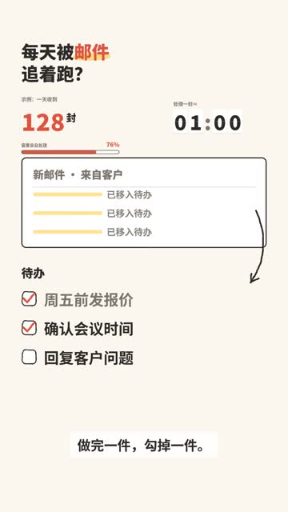
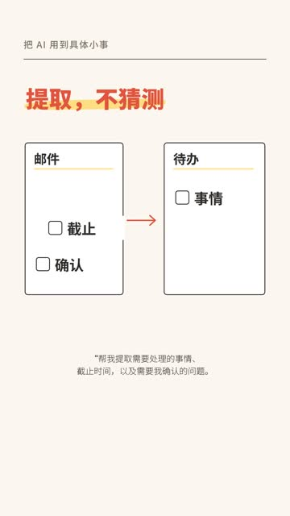

# element-motion-video · 元素级图文动画

**一句话换一张图，观众记住了几张？**

让文字、数字、时钟、箭头和清单跟着讲解出现、变化、移动、落位。这个开源 Skill 为现有 Remotion 流程补上一层可复用的元素动画：先确定每段要讲明白什么，再决定什么该动。

## 两条案例，一眼看懂

| 12 秒组件小样 | 51 秒讲解短片 |
| :---: | :---: |
| [](showcase/sample-12s.mp4) | [](showcase/email-to-todo.mp4) |
| 数字 `128`、进度 `76%`、时钟 `00:59 → 01:00`，最后把邮件事项搬进待办。<br>**[观看 MP4](showcase/sample-12s.mp4)** · [动画方案](examples/sample-12s/motion-plan.json) | 把“邮件 → 待办 → 本人确认”讲成连续流程；元素随着口播推进。<br>**[观看 MP4](showcase/email-to-todo.mp4)** |

> 第二条是展示案例：已通过自动逻辑、渲染和媒体检查，人工听看验收仍待完成。片中内容不代表对相关产品能力的独立验证。

## 它解决什么

- **信息有动作**：数字增长、时钟进位、进度推进、路径绘制、清单勾选、元素跨版位搬运。
- **讲解有承接**：前一个元素缩小、让位或移动到下一位置；一个节拍只突出一个主要动作。
- **结果可检查**：计数必须落在目标值，时钟不能出现 `:60`，随机跳帧渲染应一致，元素不能越过安全区。

已有文案、配音或字幕时使用。纯情绪片、实拍剪辑和逐帧角色动画不属于它的目标场景。

## 3 步开始

1. 将本仓库克隆到 Codex 的 `skills/element-motion-video`，或把整个文件夹放到你的 Skills 目录；阅读 [SKILL.md](SKILL.md)。
2. 在已有 Remotion v4 项目中参考 [小样](examples/sample-12s/) 写 `motion-plan.json`：每拍填 `explain`（解释什么）→ `device`（用什么动画）→ `then`（如何接到下一拍）。
3. 用 [组件](components/) 搭画面，运行 [逻辑测试](scripts/motion_logic_test.ts) 和 [真实渲染检查](scripts/render_check.mjs)，再导出 MP4。

本仓库使用 Remotion v4、`@remotion/paths`、`@remotion/bundler`、`@remotion/renderer` 和 React；逻辑测试需要 `tsx`。在装有这些依赖的项目根目录中，可运行：

```bash
npx tsx element-motion-video/scripts/motion_logic_test.ts
node element-motion-video/scripts/render_check.mjs --entry element-motion-video/examples/sample-12s/index.ts --plan element-motion-video/examples/sample-12s/motion-plan.json
node element-motion-video/scripts/render_sample.mjs --entry element-motion-video/examples/sample-12s/index.ts --out out/sample.mp4
python3 element-motion-video/scripts/quick_validate.py element-motion-video
```

中文画面默认使用 Noto Sans SC / Noto Serif CJK SC；可在项目中替换字体。接入细节见 [integration.md](references/integration.md)，版位和字幕规则见 [layout-and-captions.md](references/layout-and-captions.md)。

## 从文案到画面

```text
文案 / 配音 / 字幕
       ↓ 按语义切节拍
explain → device → then
       ↓ 选择风格、拼组件
真实渲染检查 → 抽帧审看 → MP4
```

动画方案模板在 [templates/](templates/)，内容与动画的对应规则在 [semantic-routing.md](references/semantic-routing.md)。风格有 [手写笔记](styles/handnote.md)、[编辑排版](styles/editorial.md)、[科技界面](styles/tech.md) 三套 Style Lock。Logo、片尾和声音由使用它的项目提供；技能包不附带私人声线或品牌文件。

## 许可

代码与文档采用 [MIT License](LICENSE)。案例视频用于展示本技能的效果。
